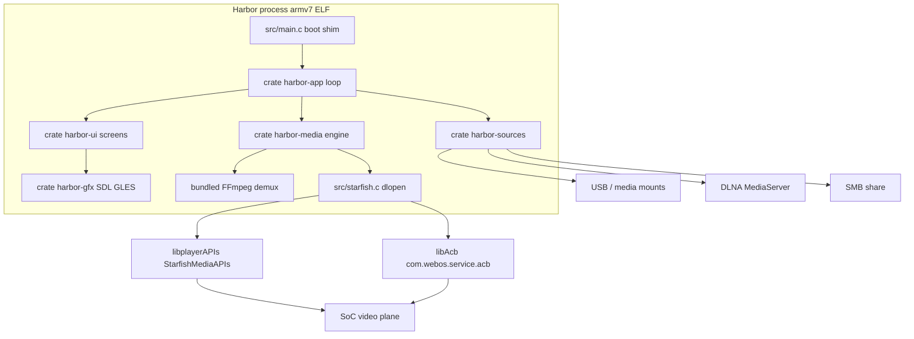

# Harbor — webOS Native Player

Feature Name: webos-native-player
Updated: 2026-11-05

> Requirements for this feature now live in OpenSpec at `openspec/specs/`
> (capabilities: `app-shell`, `browsing`, `sources`, `playback`, `resume`,
> `settings`, `errors`). This document remains the architecture / data model /
> test strategy reference.

## Description

Harbor is a native LG webOS media player. It installs as an IPK (`com.harbor.player`, working name), draws a 1920x1080 / 60 fps GPU UI with SDL2 + OpenGL ES, and plays video on the television's hardware decoder. v1 sources: local USB/internal files, DLNA/UPnP MediaServers, SMB/CIFS shares. No WebView, no transcoding, no Plex.

Stack: Rust crates for UI, sources, demux, and session logic; a small C file for `StarfishMediaAPIs` / ACB `dlopen` and callbacks. Host Linux simulator shares the UI and source crates and substitutes a software `VideoSink`.

Behavioural reference (architecture only): PlxNative's buffer-feed engine, ACB bind order, glass UI language. Harbor is an independent codebase.

## Architecture



Two stacks meet in `harbor-app`:

- Graphics: `harbor-gfx` (EGL/GLES, text, tokens) → `harbor-ui` (theme, focus, shelves, HUD widgets) → screens.
- Data: `harbor-sources` (Local / DLNA / SMB) → `harbor-session` (resume, settings, credentials) → `harbor-media` (demux, route, sink).

`harbor-platform` sits under both: keys, locale, secure store, codec table, `VideoSink` trait. The webOS port fills that trait with `StarfishSink`; the host simulator fills it with `HostSink`.

Playback default is **buffer-feed**:

1. Source adapter yields a `MediaHandle` (file fd, HTTP URL, or SMB random-access reader).
2. FFmpeg demuxes on a worker thread into an access-unit queue.
3. Main-thread pump feeds AUs into Starfish (`Feed`).
4. Firmware callbacks report `loadCompleted`, frame PTS, `sourceInfo`.
5. On webOS 4.x the pump walks ACB: bind → 2 frames → verbatim `sourceInfo` → fullscreen window → PLAYING.
6. GL HUD composites over the hardware plane.

URI-load (hand the URL to firmware) is a Phase 6 fallback, not the v1 default.

## Components and Interfaces

### Process and packaging

| Path | Role |
|---|---|
| `src/main.c` | Crash shim, `SDL_Init`, calls `harbor_run()`. |
| `src/starfish.c` | `dlopen` `libplayerAPIs` / `libAcb`; dual-ABI `dlsym` for `Feed` (webOS 3.x/4.x cxx11 vs pre-cxx11). |
| `pkg/appinfo.json` | `"type": "native"`, `"main": "harbor"`, `"resolution": "1920x1080"`, `"id": "com.harbor.player"`. |
| `Makefile` | Host sim (`cargo build -p harbor-sim`); ARM IPK when `WEBOS_NDK` is set. |

### Rust crates

| Crate | May depend on | Owns |
|---|---|---|
| `harbor-base` | — | log, paths, task, byte helpers |
| `harbor-platform` | base | `VideoSink`, keys, codec table, secure store, USB mounts |
| `harbor-gfx` | base, platform | GLES, text, size/colour tokens |
| `harbor-ui` | gfx, platform, base | theme, focus engine, Shelf, glass, Label |
| `harbor-sources` | base, platform | Local, Dlna, Smb adapters; `Source` trait |
| `harbor-session` | sources, base, platform | settings JSON, resume DB, credential vault |
| `harbor-media` | session, sources, gfx, platform, base | demux, AU queue, engine, pump, sink impls |
| `harbor-ui-kit` | ui, media, session | player HUD, track menu, source form |
| `harbor-screens` | ui-kit and below | Home, Browser, Player, Settings, Add Source |
| `harbor-app` | everything | 60 fps loop, input, port install |
| `harbor-sim` | app | Linux binary, HostSink, software decode preview |

Layer rule: a crate names only crates below it. The webOS FFI lives in `harbor-media::ffi` and `src/starfish.c`; screens never name Starfish.

### `VideoSink` trait (OS-neutral verbs)

```text
load(payload) feed(bytes, pts, es) pause play flush
set_playtime(ns) unload
window_id / window_mode          # webOS 5+
acb_bind acb_send_video_data acb_start acb_unload   # webOS 4.x, no-op on HostSink
```

`HostSink` reports `VP_EXPORTED` so the ACB stages skip. Television ACB order stays in `pump` (Phase 2), copied as behaviour from PlxNative's documented sequence, reimplemented.

### `Source` trait

```text
id, kind, display_name
list(path) -> Page<Entry>          # folder or DIDL container
open(entry) -> MediaHandle         # fd / http / smb reader
probe(entry) -> Probe              # size, duration hint, container
```

`MediaHandle` must support `read_at(offset, buf)` so the demuxer can seek. Local uses `pread`; DLNA uses HTTP `Range`; SMB uses libsmb2 pread.

### Starfish C seam

`starfish.c` exports a stable C ABI that Rust calls through `extern "C"`:

- `sf_create`, `sf_load`, `sf_play`, `sf_pause`, `sf_feed`, `sf_flush`, `sf_unload`, `sf_destroy`
- `acb_create`, `acb_bind`, `acb_send_video_data`, `acb_start`, `acb_unload`
- callbacks `sf_on_event`, `acb_on_event` implemented in Rust (`#[no_mangle]`)

`Feed` is resolved with dual-ABI `dlsym` so webOS 4.x `libplayerAPIs` (pre-cxx11 or cxx11) both work.

## Data Models

### SourceConfig

```text
SourceConfig {
  id: Uuid
  kind: Local | Dlna | Smb
  name: String
  local: { root: PathBuf }?
  dlna: { udn: String, control_url: Url }?
  smb: { host: String, share: String, username: String, domain: String }?
}
```

SMB password is stored only in `CredentialVault` keyed by `source_id`, never in `sources.json`.

### Entry / Probe / Resume

```text
Entry { id, parent, name, kind: Dir | Video | Other, size?, mtime?, thumb? }
Probe { container, video_codec, audio_codec, width, height, duration_ns, dovi? }
Resume { source_id, entry_id, position_ns, duration_ns, updated_unix }
```

Resume store: SQLite (or a length-prefixed JSON log if SQLite is too heavy for jail). Key `(source_id, entry_id)`.

### Playback session (main-thread `Engine` + cross-thread `Shared`)

Matches the race-freedom split in PlxNative's engine-port design, reimplemented:

- `Engine` (main thread only): `Stage { Idle, Loading, Playing, Bound, Streaming }`, pending AU, join handles.
- `Shared` (atomics / Mutex): playhead, frames, load_completed, media_id, source_info bytes, seek_byte, duration, cue table.

## Correctness Properties

1. **No WebView.** `appinfo.json` type is `native`. CI greps the ARM binary for Chromium/QtWebKit symbols and fails if found.
2. **Engine confinement.** Worker threads touch only `Shared`. `Engine` fields are plain values on the main thread.
3. **ACB order on 4.x.** bind → `frames >= 2` → verbatim `sourceInfo` bytes → `setDisplayWindow(0,0,1920,1080)` → PLAYING. A test records the call sequence against a fake seam.
4. **Verbatim sourceInfo.** Bytes captured from the firmware callback are handed to ACB without JSON rebuild.
5. **Seek publish-before-close.** `seek_byte` store (Release) happens before the demux socket/fd is closed.
6. **Feed backpressure.** `Feed` returning BufferFull keeps the current AU; the next pump retries.
7. **Credential isolation.** Settings JSON contains no password field. Vault files are mode 0600.
8. **Direct play or refuse.** Harbor never transcodes. Unsupported codec → error class `unsupported_codec`.
9. **Couch type.** Content text uses the size scale; caption floor is 24 px.
10. **Host green ≠ decoder proof.** Device checklist is required for Starfish/ACB/fps claims.

## Error Handling

| Failure | User-visible | Engine |
|---|---|---|
| USB path denied by jail | toast, source stays listed | no pipeline |
| DLNA SSDP timeout 8 s | empty-state + Retry | — |
| DLNA Browse / HTTP error | UPnP code or HTTP status | unload if playing |
| SMB auth fail | edit-credentials form | — |
| SMB connect 10 s timeout | network-unreachable | — |
| codec not in table | "This TV cannot decode …" | never load |
| Starfish load fail / sandbox | native-video-unavailable panel | browsing remains |
| demux/decode fail after play | toast + return to browser | unload, destroy |
| app backgrounded | — | pause; allow screensaver |

Log every load / playing / seek / error line to `$XDG_RUNTIME_DIR/harbor/events.log` (on device: app rundir).

## Test Strategy

### Host (`make check`)

- DIDL-Lite parse fixtures (MediaServer Browse XML).
- SSDP notify parse.
- SMB URL / credential canonicalization (no network).
- Resume store round-trip and 90% clear rule.
- Focus reducer: Home empty-state, shelf wrap, Back stack.
- Fake `VideoSink`: load/feed/pause/seek call order; BufferFull retry; ACB sequence on a 4.x fake.
- Demux of checked-in tiny clips (H.264 MP4, HEVC MKV) into AU counts.

### Simulator (`make sim`)

- UI smoke at 1920x1080 under Xvfb.
- Play a local sample through HostSink; HUD pause/seek keys.

### Device (documented, not CI)

- USB file Direct Play on webOS 4.x: picture + sound + ACB bind in log.
- Seek lands within 2 s of target on a file with cues.
- DLNA play from a MiniDLNA/ReadyMedia host on the LAN.
- SMB play from a Samba share with and without password.
- Background pause; foreground resume.
- k5lp/k3lp sandbox: unavailable panel instead of crash.

## Implementation plan

Work is sequential. Each phase ends with a host-checkable artifact. Device work is called out.

### Phase 0 — Native shell (Req 1, 13)

Deliverable: Linux simulator window at 1920x1080 clearing to theme background, responding to arrow keys; IPK skeleton (`appinfo.json`, icons, `ares-package` recipe) that documents the ARM NDK gap.

- Cargo workspace, crate graph, `harbor-base` log/paths.
- `harbor-gfx` SDL2 window, GLES clear, vsync present loop.
- `harbor-platform` key map (webOS remote scancodes + host keyboard).
- `src/main.c` + `harbor_run` for the device binary shape; sim uses `harbor-sim`.
- `pkg/appinfo.json`, icons 80/130, splash 1920x1080.
- Makefile: `make sim`, `make check`, `make ipk` (ipk fails with a clear message if NDK absent).
- LICENSE (MIT or Apache-2.0 — independent code; confirm with user).

Exit: `make sim` shows a coloured frame; `make check` runs empty-ish unit tests.

### Phase 1 — UI kit, Home, browser, Settings shell (Req 2, 10, 11)

Deliverable: navigable Home / Browser / Settings with fake entries.

- Theme tokens, Label, Shelf, glass panel, scrim, focus engine.
- Screens: Home (hero + Continue + Recent + Sources row), Browser (list + A–Z + sort), Settings (source list placeholder), empty-state Add Source.
- Back stack. Size scale enforced by a unit test that scans draw calls in a recording harness.

Exit: simulator walk Home → Browser → Back → Settings with keyboard.

### Phase 2 — Local files + Starfish buffer-feed (Req 3, 6, 7, 8, 12)

Deliverable: host plays a sample through HostSink; device code path exists behind `StarfishSink`.

- Local source: enumerate USB/media with jail-safe roots (host: `$HARBOR_MEDIA` dir).
- FFmpeg demux + AU queue + pump + HostSink (software decode to GL texture for sim).
- Starfish C seam + `StarfishSink` + ACB state machine (compiled for ARM; on host, tests use FakeSink).
- Player screen: HUD, pause, ±10 s seek, Back unloads.
- Sandbox probe stub: if `sf_create` fails, show unavailable panel.

Exit: `make sim` plays a file from a folder; FakeSink tests lock ACB order and backpressure. Real TV play is Phase 2 device gate, blocked on NDK.

### Phase 3 — Resume, tracks, subtitles (Req 7, 9)

- Resume store, Continue / Start over prompt, 10 s / pause / stop persist, 90% clear.
- Audio/subtitle track list from demuxer; select applies to current session.
- SRT/VTT overlay; ASS/SSA basic (styles later). PGS if time.

Exit: simulator resume after kill; subtitle overlay on a fixture with SRT.

### Phase 4 — DLNA (Req 4)

- SSDP client, device list, ContentDirectory Browse, DIDL-Lite.
- HTTP `MediaHandle` with Range.
- Add Source → DLNA flow; 8 s timeout empty-state.

Exit: host test against a recorded SSDP/DIDL fixture; optional live test vs MiniDLNA on localhost.

### Phase 5 — SMB (Req 5)

- Add Source form: host, share, user, password, domain.
- libsmb2 (or smb crate) directory list + `read_at`.
- Credential vault; auth-fail and 10 s timeout states.

Exit: unit tests for form validation and path canonicalization; optional live Samba in CI is out of scope.

### Phase 6 — Capability table, DV, webOS 5+, polish (Req 6, 12)

- Parse `device_codec_capability_config.json`; refuse unsupported codecs before load.
- Dolby Vision profile 5/8 when table lists DV.
- webOS 5+ exported `windowId` load option; 4.x keeps ACB.
- URI-load fallback experiment (optional).
- Screensaver block while playing; background pause.
- i18n en + zh-Hans.

Exit: decision table tests; documented device matrix.

## Build constraints (this workspace)

Current agent host is x86_64 Linux. Official webOS NDK has no x86_64 Linux toolchain. Consequences:

- Daily loop is `make sim` + `make check` on the host.
- ARM IPK is a separate target: enable when an arm64 builder or a pre-fetched NDK sysroot is available.
- Starfish/ACB are compile-tested with stub headers on host; link-tested only on ARM.

## License

Independent implementation. Harbor application code is **MIT**. Bundled FFmpeg remains **LGPL** and ships with its licenses in `licenses/`. Phase 0 lands `LICENSE` as MIT when coding starts.

## References

- PlxNative README and module layers: https://github.com/GLinnik21/plx-native
- PlxNative URI mode / 4.x ACB vs 5+ windowId: `docs/uri-mode.md`
- PlxNative engine-port design (buffer-feed threading): `docs/engine-port-design.md`
- webOS `appinfo.json`: https://webostv.developer.lge.com/develop/references/appinfo-json
- webOS 4.x ACB: `libAcb` → `com.webos.service.acb`
- SSDP / UPnP AV ContentDirectory: UPnP Device Architecture 1.1, ContentDirectory:1
- libsmb2: https://github.com/sahlberg/libsmb2
